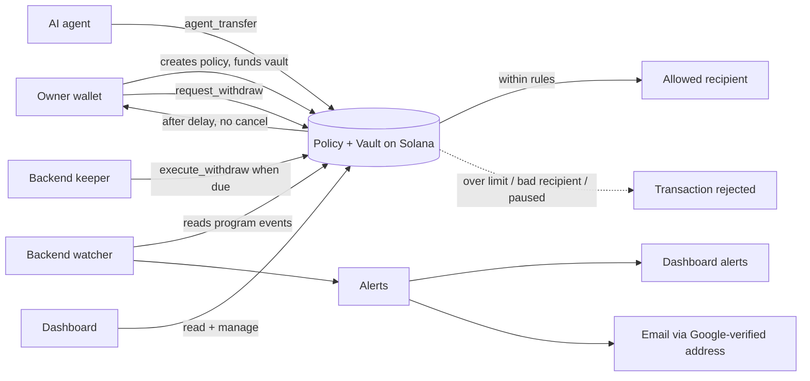

# SpendGuard

> Give your AI agent a wallet it can't abuse.

SpendGuard is a Solana program, an AI agent, and a dashboard that work together so an AI can pay for things (APIs, data, compute) **inside spending rules that are enforced on-chain**. The owner writes the rules once. After that, even a confused, buggy, or prompt-injected agent cannot spend past them, because the Solana program rejects the transaction. If something unusual happens, SpendGuard alerts the owner on the website and by email.

**Status:** hackathon prototype built for the MLH Solana Hackathon (AI Track). Devnet only. Unaudited.

> **For coding agents:** read this file first, then read `AGENTS.md` in the repo root. `AGENTS.md` holds the build order, exact specs, and rules you must follow.

---

## The problem

AI agents that can pay need a wallet. Today there are two bad options:

1. **Give the agent full access to the wallet.** One prompt injection or bug and the funds are gone.
2. **Check limits in off-chain code.** The same code that is being attacked is the thing enforcing the limits.

## The solution

The owner funds a **vault** that only the SpendGuard program can move money out of. The agent holds a separate key that can do exactly one thing: call `agent_transfer`. On every payment the program checks:

- Is the policy paused? (owner kill switch)
- Is the amount within the **per-transaction limit**?
- Is the recipient on the **allowlist**?
- Is the total within the **window limit** (for example, a daily cap)?

If any check fails, the transaction reverts. The AI never has the power to bypass this, no matter what it is told.

**Withdrawals are delayed.** The owner cannot pull money out instantly. A withdrawal is first *requested*, then waits for a delay chosen when the policy is created (30 minutes by default). During that time the owner gets an alert and can cancel. If nobody cancels, the withdrawal is released to the owner automatically.

**Unusual activity raises alerts.** A new recipient, a payment much larger than usual to a known recipient, a blocked attempt, a pending withdrawal: each creates an alert on the website, and an email if the owner has signed in with Google.



## Why Solana

A normal agent payment costs the base fee of 5,000 lamports (0.000005 SOL) per signature and settles in about a second. That makes it practical to run a policy check on **every single payment**, including very small per-request ones, and to watch the chain for alerts in near real time.

## Features

Tick these off as they are built.

**Smart contract**
- [x] Create a policy: per-tx limit, window limit, window length, withdrawal delay, recipient allowlist
- [x] Fund the vault
- [x] Agent payments enforced on-chain (per-tx limit, window limit, allowlist)
- [x] Owner kill switch (pause / resume)
- [x] Add recipients later (add-only, recipients are never removed)
- [x] Delayed withdrawals: request, cancel, execute after the delay
- [x] Limits and window length are fixed after creation

**Backend**
- [x] AI agent (LLM via Groq) that decides what to buy and pays through the program
- [x] Attempt log (successful and rejected)
- [x] Chain watcher that turns program events into alerts
- [x] Anomaly detection: new recipient, unusually large amount, near the window limit
- [x] Keeper that executes due withdrawals automatically
- [x] Sign in with Google, linked to the owner's wallet by a signed message
- [x] Email alerts

**Frontend**
- [x] Create-policy wizard with a clear "this cannot be changed" review step
- [x] Dashboard with limits, spent progress, vault balance, status, pause button
- [x] Pending withdrawal card with countdown and cancel button
- [x] Alert bell and critical alert banner
- [x] Activity page: payments, blocked attempts, scenario runner
- [x] Notification settings (Google sign-in, email on or off)

## How alerts work

| Alert | Trigger | Severity |
|---|---|---|
| Withdrawal requested | Owner calls `request_withdraw` | critical |
| Withdrawal executed | Funds released after the delay | warning |
| Withdrawal cancelled | Owner cancels a pending request | info |
| Payment blocked | The program rejected an agent payment (for example, recipient not allowed) | critical if recipient not allowed, otherwise warning |
| Recipient added | Owner adds a recipient | warning |
| New recipient payment | First successful payment to a recipient | warning |
| Unusual amount | Payment is several times larger than that recipient's usual payments (defaults: at least 3 earlier payments, 3x their average) | warning |
| Near window limit | Spending reaches 80% of the window limit | warning |
| Paused / resumed | Owner toggles the kill switch | info |

Alerts are **notifications, not blocks.** The hard blocks come from the on-chain rules. Unusual-but-allowed payments go through and are flagged so the owner can react.

## Withdrawal delay

1. Owner presses **Withdraw**. The program records the amount and an unlock time (now plus the policy's delay). Those funds are reserved, so the agent can no longer spend them.
2. The dashboard shows a countdown, and an alert is created (and emailed).
3. The owner can **cancel** at any time before the unlock time.
4. After the unlock time, anyone can call `execute_withdraw`, but the money can only go to the owner's address. The backend keeper does this automatically, and the owner can also press **Release** in the dashboard.

Solana programs cannot run themselves on a timer, so the keeper exists to make the release feel automatic.

## Sign in with Google

Signing in with Google gives the backend a verified email address to send alerts to. The wallet is linked to that email by signing a one-time message with the wallet, so nobody can attach their email to someone else's policy. Alerts on the website work without signing in. Google sign-in only adds email delivery.

## Tech stack

| Part | Tech |
|---|---|
| Smart contract | Rust, Anchor |
| Contract tests | TypeScript, Mocha (Anchor's default test template) |
| Backend | Node.js, TypeScript, Express, SQLite, `openai` (OpenAI-compatible client for Groq), Nodemailer, Google Auth Library |
| Frontend | Next.js (App Router), TypeScript, Tailwind CSS, Solana wallet adapter, Google sign-in button |
| Network | Solana devnet (local validator for development) |

## Repository structure

```
spendguard/
├── README.md        # you are here
├── AGENTS.md        # instructions and specs for coding agents
├── contracts/       # Anchor workspace (Rust program + Mocha tests)
├── backend/         # AI agent, watcher, keeper, alerts, auth, HTTP API
├── frontend/        # Next.js dashboard
├── scripts/         # helper scripts (e.g. sync IDL to frontend and backend)
└── docs/            # design notes, diagrams, screenshots
```

## Getting started

### Prerequisites

- Rust, Solana CLI, and Anchor installed (check with `solana --version` and `anchor --version`)
- Node.js 20 or newer and Yarn
- A Groq API key (free at console.groq.com)
- A Solana wallet browser extension (Phantom, Solflare, or similar) set to **devnet**
- A Google Cloud OAuth client ID (for Sign in with Google)
- SMTP credentials for sending email (a Gmail account with an app password works, or any SMTP provider)

### 1. Smart contract

```bash
cd contracts
yarn install
anchor build
anchor test            # starts a local validator, deploys, runs the tests
```

Deploy to devnet:

```bash
solana config set --url devnet
solana airdrop 2        # or use https://faucet.solana.com if rate limited
anchor build
anchor program deploy
```

Copy the printed program ID into `Anchor.toml`, `declare_id!`, and your `.env` files.

### 2. Sync the IDL

After every `anchor build`, copy the generated IDL and types so the backend and frontend stay in step with the program:

```bash
./scripts/sync-idl.sh
```

### 3. Google sign-in setup

1. In Google Cloud Console, create an OAuth client of type **Web application**.
2. Add `http://localhost:3000` as an authorized JavaScript origin.
3. Put the client ID in `GOOGLE_CLIENT_ID` (backend) and `NEXT_PUBLIC_GOOGLE_CLIENT_ID` (frontend).

### 4. Backend

```bash
cd backend
cp .env.example .env    # fill in the values
yarn install
yarn dev
```

Fund the agent and keeper wallets with a little devnet SOL for transaction fees.

### 5. Frontend

```bash
cd frontend
cp .env.example .env.local
yarn install
yarn dev                # http://localhost:3000
```

### Environment variables

| Variable | Used by | Meaning |
|---|---|---|
| `RPC_URL` | backend, frontend | Solana RPC endpoint (devnet) |
| `PROGRAM_ID` | backend, frontend | Deployed program ID |
| `LLM_BASE_URL` | backend | OpenAI-compatible endpoint (Groq: `https://api.groq.com/openai/v1`) |
| `LLM_API_KEY` | backend | Groq API key |
| `LLM_MODEL` | backend | Model name (see Groq docs for the current one) |
| `AGENT_KEYPAIR_PATH` | backend | Agent keypair file (devnet only, never commit) |
| `KEEPER_KEYPAIR_PATH` | backend | Keeper keypair file that pays fees for releases (devnet only, never commit) |
| `POLICY_ADDRESS` | backend | Policy the agent operates under |
| `GOOGLE_CLIENT_ID` | backend | Google OAuth client ID, used to verify ID tokens |
| `JWT_SECRET` | backend | Secret for signing session tokens |
| `SMTP_HOST`, `SMTP_PORT`, `SMTP_USER`, `SMTP_PASS`, `EMAIL_FROM` | backend | Email sending |
| `UNUSUAL_MULTIPLIER` | backend | Default 3 |
| `UNUSUAL_MIN_HISTORY` | backend | Default 3 |
| `NEAR_LIMIT_PERCENT` | backend | Default 80 |
| `NEXT_PUBLIC_BACKEND_URL` | frontend | Backend URL |
| `NEXT_PUBLIC_GOOGLE_CLIENT_ID` | frontend | Google OAuth client ID |

## Demo walkthrough

1. **Owner** connects a wallet, signs in with Google, creates a policy, and funds the vault.
2. **Agent** is given a task and makes a legitimate payment. It appears on Solana Explorer (devnet), and the first payment to a recipient raises a "new recipient" alert.
3. **Overspend:** the agent tries to pay more than the limit. The program rejects it and a "payment blocked" alert appears.
4. **Prompt injection:** a task hides instructions telling the agent to ignore its limits and send everything to an unknown address. The agent tries, and the program rejects it.
5. **Unusual amount:** the agent pays a known recipient several times its usual amount. The payment succeeds and an alert is raised.
6. **Kill switch:** the owner pauses the policy and the agent is blocked immediately.
7. **Delayed withdrawal:** the owner requests a withdrawal. An alert and an email arrive, the countdown starts, and cancelling stops it. Left alone, the keeper releases it after the delay.

## Security model

**What the program guarantees:**

- The agent key can only call `agent_transfer`. It cannot withdraw, add recipients, pause, or unpause.
- Every payment is checked against the policy inside the program. Client-side code cannot skip this.
- Limits, window length, and withdrawal delay cannot be changed after creation. Recipients can only be added, never removed.
- Withdrawals cannot be instant. Funds reserved for a pending withdrawal cannot be spent by the agent.
- Released withdrawals can only go to the owner's address.

**Known limits:**

- The owner key is fully trusted. A thief holding it can also cancel the real owner's actions or add recipients. The delay and alerts give the real owner time to react, but they do not stop a determined attacker who controls the key.
- Alerts do not block anything. Only the on-chain rules block.
- An allowlisted recipient that is itself malicious can still receive funds up to the limits.
- Rejected transactions revert and leave no on-chain record. Blocked attempts are logged by the backend.
- Funds are native SOL only in this version.
- Email delivery depends on the backend being online. The on-chain rules do not.
- Prototype code. Not audited. Devnet only. Do not use with real funds.

## Built for

MLH Solana Hackathon, November 6 to 8, 2026. Track: **AI Track** (the AI decides what to buy, and Solana enforces what it is allowed to spend).

## Roadmap

- A separate **guardian key** that can pause and cancel withdrawals but never withdraw, to protect against a stolen owner key
- SPL token support (USDC)
- Multiple agents per owner and per-recipient limits
- Holding unusual payments for approval instead of only alerting
- Natural-language policy setup with confirmation before signing
- Pay-per-request integrations for real AI and data APIs

## Author

Rave https://paranormalrave.dev

## License

MIT
